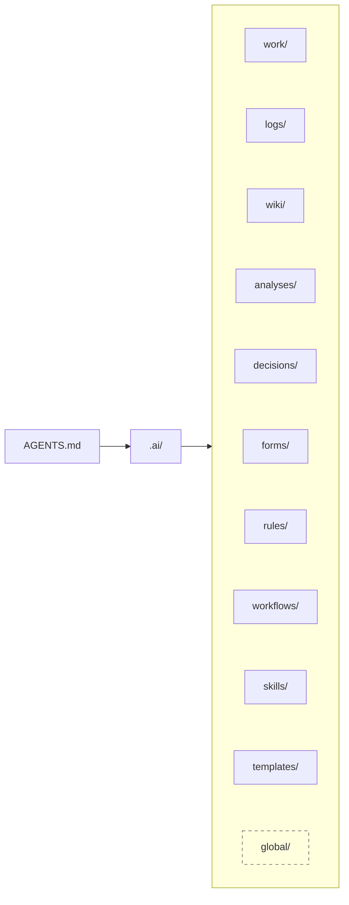
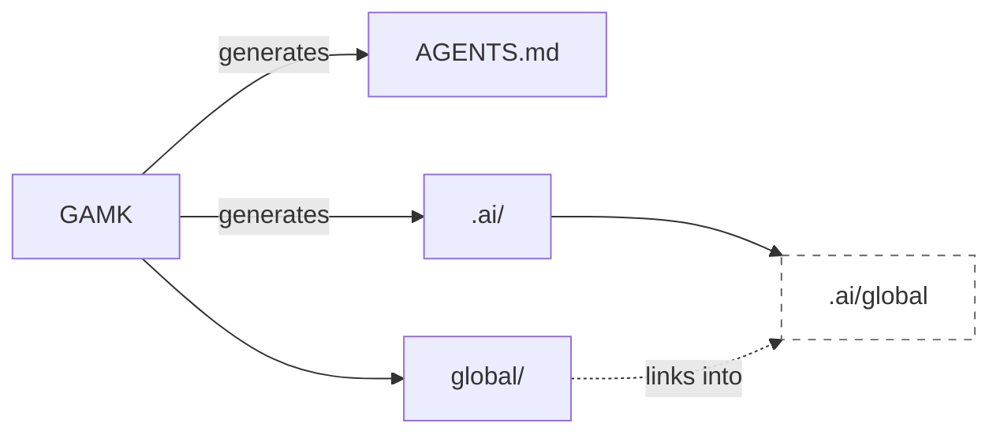
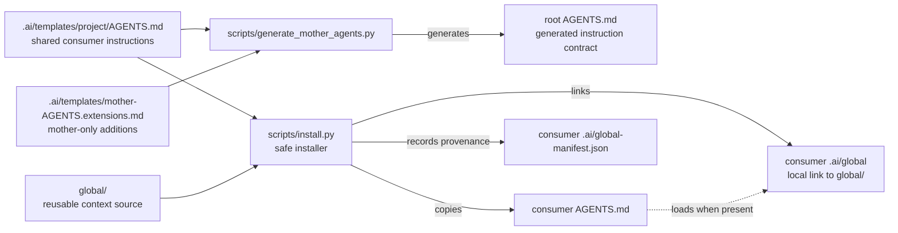

# GAMK — Git Agent Memory Kit

## Give your agent a durable memory for the project

Most agents are good at solving the next problem. The expensive part is making them remember the decisions, constraints, conventions, unfinished work, and lessons that came before it.

GAMK turns that missing memory into a project-owned, Git-tracked system of context. Instead of repeating the same explanation in every session, the agent can discover the project's instructions, decisions, logs, rules, workflows, skills, and active tasks where the project already lives.

The result is an agent that can:

- resume work with context instead of starting from zero;
- preserve decisions and the reasons behind them;
- follow the project's rules consistently;
- leave a useful trail for the next person or agent;
- understand what is active, paused, blocked, done, or next;
- work with the project's existing instructions instead of silently replacing them.

GAMK is the kit that makes this possible in another repository. It provides the reusable memory structure, the agent instructions that explain how to use it, and safe scripts for installing that structure into a consumer project.

## The project-side view: `AGENTS.md` first



The boxes follow the memory order in `AGENTS.md`; `global/` is optional shared context linked through `.ai/global`.

### Where the structure comes from



GAMK generates `AGENTS.md` and `.ai/`; the repository's `global/` is exposed through the `.ai/global` link.

The important shift is that the agent does not begin with an abstract “memory system”. It begins with `AGENTS.md`, then follows the project's own map to the task state, history, decisions, knowledge, rules, capabilities, and reusable structures. GAMK does not force a cloud service, a model vendor, or a particular editor; the memory remains inspectable files in the project.

## What GAMK gives you

| Benefit | What changes in practice |
| --- | --- |
| Continuity | The next session reads the project's durable context instead of relying on chat history. |
| Consistency | Shared `AGENTS.md`, rules, and workflows give agents a stable operating contract. |
| Traceability | Decisions and logs preserve not only what changed, but why. |
| Safer onboarding | New agents discover the same structure and task state from the repository. |
| Controlled evolution | Template improvements produce evidence for migration; they do not overwrite project-owned context. |
| Portability | The memory is Git-tracked Markdown and JSON, usable from any compatible agent. |
| Low operational risk | Installation plans first, writes explicitly, and refuses to replace existing context. |

## Install GAMK into another project

This repository is the source. A consumer project is the project that receives the memory structure.

### 1. Get GAMK

```bash
git clone git@github.com:marcosrdac/gamk.git
cd gamk
```

If you already have a checkout, use it directly. The commands below are run from that checkout.

### 2. Inspect before changing anything

```bash
scripts/install.sh plan /path/to/your-project
```

`plan` is read-only. It detects existing `AGENTS.md`, `.ai/`, common agent configuration, and destination collisions. It prints the source commit, the target paths, and a migration prompt for the agent responsible for the target project.

### 3. Install when the project is genuinely new

```bash
scripts/install.sh install /path/to/your-project
```

The normal installation creates:

- a consumer `AGENTS.md`;
- the standard `.ai/` memory directories;
- `.ai/global-manifest.json` with source provenance;
- a local `.ai/global` link to this GAMK checkout.

The installer runs its complete preflight before writing. If the target already contains meaningful agent context, it stops without changing anything. In that case, give the plan to the target project's agent, review the migration with the user, preserve the existing material, and run `install` only after the approved migration is complete.

### 4. Check the installed relationship

```bash
scripts/install.sh status /path/to/your-project
```

`status` is read-only. It checks whether the recorded schema and source commit still agree with the GAMK source reachable through `.ai/global`. It reports `current`, `not installed`, or `attention required`; it never performs an upgrade.

### PowerShell

The same flow works from PowerShell:

```powershell
./scripts/install.ps1 plan 'C:\path\to\your-project'
./scripts/install.ps1 install 'C:\path\to\your-project'
./scripts/install.ps1 status 'C:\path\to\your-project'
```

The wrappers can use `python3`, `python`, `py -3`, or Nix when available.

## Pick the right installation path

| Path | Best for | What it does |
| --- | --- | --- |
| `copy-install` | A genuinely empty project without Python | Copies the basic `AGENTS.md` and creates the `.ai/` directories. No link, manifest, or full detection. |
| `install` / `full` | The normal setup | Installs the shared structure, provenance, and local global link. |
| `install --local` | A project that should not use personal global context | Installs the shared structure and provenance, but intentionally leaves out `.ai/global`. |
| `install --mode global` | Link-only setup | Creates only the local `.ai/global` link. |
| `repair-link` | A moved or broken GAMK checkout | Repairs a broken/stale symlink after review; refuses real files/directories. |

Examples:

```bash
# Python-free minimal bootstrap for a clean project.
scripts/copy-install.sh /path/to/new-project

# Shared structure without the personal global link.
scripts/install.sh install /path/to/project --local

# Link-only installation using the exact link destination.
scripts/install.sh install /path/to/project/.ai/global

# Repair after moving this GAMK checkout.
scripts/install.sh repair-link /path/to/project
```

The consumer's `.ai/global` link contains a machine-specific path and should normally be ignored by that project's Git configuration. GAMK does not edit `.gitignore`, `.git/info/exclude`, or the index for you.

## How an agent uses the installed memory

The installed `AGENTS.md` gives the agent the startup contract. In broad terms, the agent should:

1. discover the project's applicable rules, then follow relevant workflows and consult useful skills;
2. inspect `.ai/work/doing/` before starting new work;
3. preserve continuity in tasks, logs, wiki, analyses, decisions, and forms;
4. follow the project's instructions before optional global defaults;
5. ask before consequential migrations or destructive changes;
6. close completed tasks and clean temporary worktrees safely.

The directories have distinct jobs:

- `work/` is the execution queue: active, next, backlog, blocked, done, and abandoned work;
- `logs/` is the chronological project journal;
- `wiki/` is the current, consolidated project knowledge;
- `analyses/` stores substantial research with evidence and conclusions;
- `decisions/` stores durable commitments and trade-offs;
- `forms/` stores structured, asynchronous user decisions;
- `global/` is optional shared context, either a directory or local symlink;
- `rules/` contains mandatory context-specific behavior;
- `workflows/` stores repeatable procedures;
- `skills/` stores specialized approaches;
- `templates/` contains reusable document structures.

This division prevents a chat transcript, a task queue, current knowledge, a permanent decision, and a one-off analysis from becoming one unsearchable pile.

## Safety and migration model

GAMK uses a read-first, explicit-write model:

- `plan` never writes to the target;
- `status` never writes to the target;
- `install` completes its full preflight before its first write;
- existing instructions, `.ai/`, known agent configuration, and occupied generated destinations block installation;
- an existing `AGENTS.md` is never merged or replaced automatically;
- `--yes` never bypasses preflight;
- no command automatically upgrades a consumer or rewrites its manifest;
- `repair-link` never replaces a real file or directory;
- the installer does not change Git ignore rules or the index.

An existing project is not a blank canvas. The target project's agent must compare old and new context, explain the consequences, ask the user about consequential changes, preserve legacy material, and rerun the installer after the approved migration.

## Command reference

### `plan [TARGET]`

Read-only preflight and migration prompt. A missing subcommand in the Bash wrapper defaults to `plan`.

### `status [TARGET]`

Read-only source/provenance check. It compares `.ai/global-manifest.json`, `global/manifest.json`, and the Git checkout reachable through `.ai/global`.

The normal results are:

- `Status: current` — the available source agrees with the recorded installation;
- `Status: not installed` — no consumer manifest or global link exists;
- `Status: attention required` — the link or manifest is missing/invalid, the schema differs, the source advanced or diverged, or source identity cannot be checked.

It returns zero for current/not-installed states and nonzero when attention is required. Local mode without `.ai/global` is expected and skips source-checkout comparison.

### `install [TARGET]`

Explicit write operation after a clean preflight. The default mode is `full`; use `--local`, `--mode local`, or `--mode global` as appropriate. `--yes` is compatibility-only and cannot override a block.

### `repair-link [TARGET]`

Repairs a broken or stale link to this checkout's `global/` directory after review.

### `plan-mother` and `init-mother`

Read-only checks for GAMK's own tracked relative link:

```text
.ai/global -> ../global
```

`init-mother` is retained as a legacy command name. Neither command creates or changes that source link.

## Provenance and compatibility

The source manifest at `global/manifest.json` identifies the GAMK source and structural schema:

```json
{
  "format": "gamk-source",
  "schema_version": 2,
  "repository_name": "gamk"
}
```

A full or local consumer receives `.ai/global-manifest.json`:

```json
{
  "format": "gamk-consumer",
  "schema_version": 2,
  "source_url": null,
  "base_commit": "<full Git commit>",
  "installation_mode": "full"
}
```

The consumer manifest records a credential-free source URL when available, the full source commit used for installation, the structural schema, and the installation mode. It never records the machine-specific absolute path stored in `.ai/global`.

Schema 2 uses `analyses/` for the research area. Existing consumer projects are not renamed automatically; their local state remains untouched until an explicit, user-approved migration.

GAMK still reads the previous `git-ai-global-source`, `git-ai-global-consumer`, and `git-ai-global` identifiers so existing installations are not made unreadable by the public rename. New installations write GAMK identifiers.

## Inside the GAMK repository

The repository is both a reusable source and a maintained project in its own right:



GAMK creates the instruction contract and the reusable source that contract can discover. In the mother repository, `.ai/global -> ../global` is tracked; in a consumer project, `.ai/global` is a local machine-specific link. The generated `AGENTS.md` is the entrypoint, while `global/` is the reusable source layer exposed through that link when available.

```text
gamk/
├── global/
│   ├── rules/                       Reusable rules
│   ├── workflows/                  Reusable procedures
│   ├── skills/                      Reusable skills
│   ├── INDEX.md                     Global-context loading map
│   └── manifest.json                Source identity/schema
├── scripts/
│   ├── install.py                   Plan/install/status/repair implementation
│   ├── install.sh                   Bash entrypoint
│   ├── install.ps1                  PowerShell entrypoint
│   ├── copy-install.*               Minimal Python-free installers
│   ├── generate_mother_agents.py    Root instruction generator
│   └── finish-worktree.py           Safe completed-worktree cleanup
├── .ai/
│   ├── work/                        This repository's task state
│   ├── logs/                        Project journal
│   ├── wiki/                        Current architecture/operations knowledge
│   ├── decisions/                   Architectural commitments
│   ├── templates/project/           Local consumer AGENTS.md template
│   ├── rules/                       Mother-local mandatory rules
│   ├── workflows/                  Mother-local procedures
│   └── skills/                      Mother-local capabilities
├── AGENTS.md                        Generated mother instructions
└── README.md                        This entrypoint
```

`.ai/templates/project/AGENTS.md` is the canonical shared instruction source and remains local to GAMK. The root `AGENTS.md` is generated from that template plus `.ai/templates/mother-AGENTS.extensions.md`; it must not be edited by hand. Consumer projects receive the generated `AGENTS.md`, not this source template.

## How to maintain GAMK

### 1. Track work before acting

Every substantive activity gets a task in `.ai/work/`. Keep the branch, worktree, objective, progress, next action, tests, and related decisions/logs resumable. Keep at most one active task per worktree.

### 2. Work in an isolated worktree

Create feature worktrees under `.git-worktrees/`, make the branch clean and testable, and integrate completed work directly into `main`. GAMK does not use a `dev` branch.

### 3. Change shared instructions through the generator

When changing agent instructions:

1. put consumer-shared text in `.ai/templates/project/AGENTS.md`;
2. put mother-only text in `.ai/templates/mother-AGENTS.extensions.md`;
3. run `python scripts/generate_mother_agents.py`;
4. run it again with `--check`;
5. verify that private mother content did not leak into the consumer template.

### 4. Test the source and wrappers

```bash
nix shell nixpkgs#python3 --command python3 scripts/test_install.py
nix shell nixpkgs#python3 --command python3 scripts/test_finish_worktree.py
nix shell nixpkgs#python3 --command python3 scripts/test_powershell_wrappers.py
nix shell nixpkgs#python3 --command python3 scripts/generate_mother_agents.py --check
bash -n scripts/install.sh scripts/copy-install.sh
git diff --check
```

The tests cover safe preflight, installation modes, provenance compatibility, status divergence, Bash forwarding, PowerShell parsing/forwarding, copy-only setup, the tracked source link, and worktree cleanup refusal/success paths.

### 5. Close and clean the worktree

A worktree is temporary execution space, not permanent project inventory. When a task is done:

```text
create → implement → test → close task → integrate into main
       → dry-run cleanup → apply cleanup
```

From the clean `main` checkout, validate first:

```bash
nix shell nixpkgs#python3 --command python3 scripts/finish-worktree.py \
  .git-worktrees/<worktree-name>
```

Then apply only if it passes:

```bash
nix shell nixpkgs#python3 --command python3 scripts/finish-worktree.py \
  .git-worktrees/<worktree-name> --apply
```

The helper refuses a current, dirty, active, detached, or unmerged worktree. It uses neither `git worktree remove --force` nor `git branch -D`. See [`20261102_2321_finish-completed-worktree.md`](.ai/workflows/20261102_2321_finish-completed-worktree.md).

## Windows and NixOS boundaries

PowerShell Core can be probed from NixOS for parsing, argument forwarding, no-write behavior, and Linux-side installation. That is useful evidence, but it does not prove native Windows behavior.

Native Windows validation is still required for NTFS symlink permissions, `cmd.exe mklink /J` junction fallback, Windows path semantics, and native PowerShell filesystem behavior. Until those scenarios run on a Windows host or Windows CI runner, GAMK describes Windows support as unverified.

## Documentation map

- [`global/INDEX.md`](global/INDEX.md) — reusable agent context and loading rules;
- [`gamk.md`](.ai/wiki/gamk.md) — architecture and operations;
- [`20261102_2200_update-agent-instructions.md`](.ai/workflows/20261102_2200_update-agent-instructions.md) — generated instruction workflow;
- [`20261102_2321_finish-completed-worktree.md`](.ai/workflows/20261102_2321_finish-completed-worktree.md) — completed-worktree lifecycle;
- [`20261102_2005_agents-parity.md`](.ai/skills/20261102_2005_agents-parity.md) — shared/mother instruction parity;
- [`20261102_2005_structural-upgrade.md`](.ai/skills/20261102_2005_structural-upgrade.md) — deliberate consumer upgrades;
- [`20261102_2239_powershell-wrapper-validation.md`](.ai/skills/20261102_2239_powershell-wrapper-validation.md) — NixOS PowerShell validation.

## In short

GAMK gives an agent a place to remember how a project works, gives humans a place to review why it changed, and gives both a safe way to carry that system into another repository.
